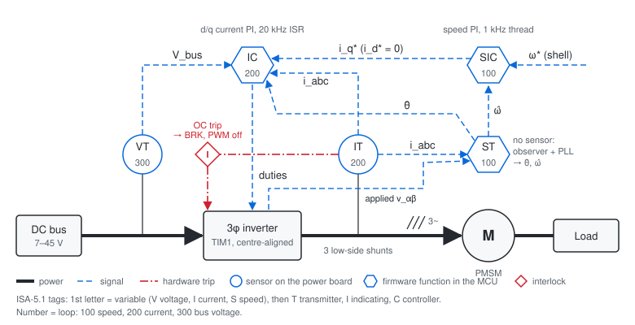
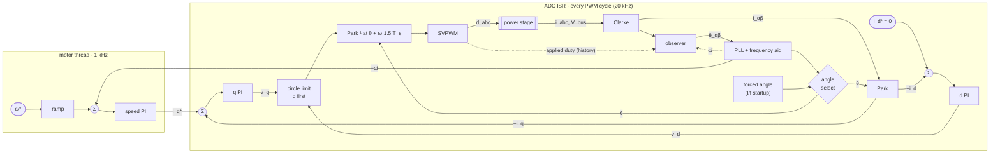
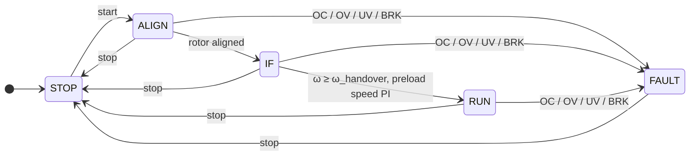
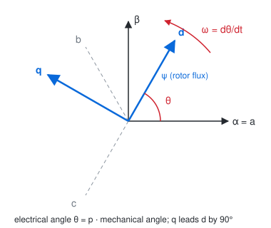
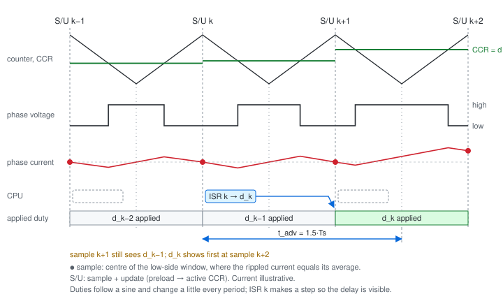
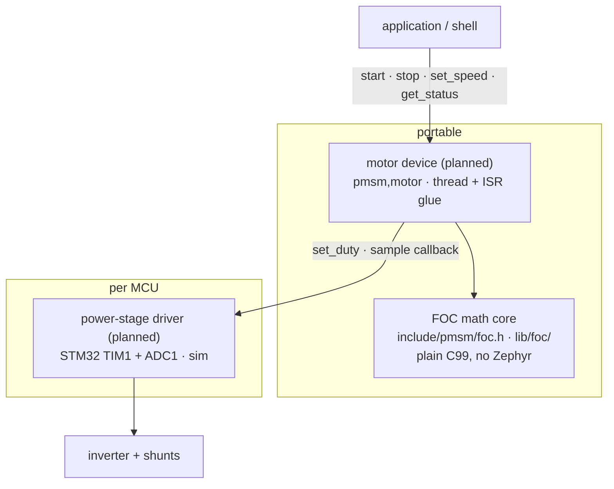

# spin

Sensorless field-oriented control (FOC) for PMSMs, as an out-of-tree Zephyr module.
Textbook algorithms, float32, MCU-agnostic except for one power-stage driver.

Status, decisions and milestones: [docs/PLAN.md](docs/PLAN.md) · hardware: [docs/HARDWARE.md](docs/HARDWARE.md)
· backlog: [docs/FEATURES.md](docs/FEATURES.md). Parts marked *(planned)* are not implemented yet.

API reference: Doxygen in the headers, today only the math core [include/pmsm/foc.h](include/pmsm/foc.h).
The motor device API (`start`, `stop`, `set_speed`, `get_status`) and its devicetree binding come in M4,
see [docs/PLAN.md](docs/PLAN.md).

## Control loop



Symbols and tags follow ISA-5.1.

Cascade: an outer speed loop sets the q current, an inner current loop sets the voltage. There is no
position sensor: an observer estimates angle and speed from the measured currents and the applied voltage.

## Signal flow



## Startup *(planned, M3)*



ALIGN: fixed current on d at θ = 0. IF: current loop closed, angle ramped open-loop. RUN: observer angle,
speed loop closed.

## Reference frames



**Amplitude-invariant** Clarke: a balanced set of peak amplitude *Î* maps to a vector of length *Î*, so dq
values read directly as phase peak values.

$$
\begin{bmatrix} x_\alpha \\ x_\beta \end{bmatrix}
= \frac{2}{3}\begin{bmatrix} 1 & -\tfrac12 & -\tfrac12 \\ 0 & \tfrac{\sqrt3}{2} & -\tfrac{\sqrt3}{2} \end{bmatrix}
\begin{bmatrix} x_a \\ x_b \\ x_c \end{bmatrix}
\qquad
\begin{bmatrix} x_d \\ x_q \end{bmatrix}
= \begin{bmatrix} \cos\theta & \sin\theta \\ -\sin\theta & \cos\theta \end{bmatrix}
\begin{bmatrix} x_\alpha \\ x_\beta \end{bmatrix}
$$

The price is a factor 3/2 in power and torque (power-invariant scaling would hide it in ψ and the currents):

$$
P = v_a i_a + v_b i_b + v_c i_c = \tfrac32\,(v_d i_d + v_q i_q)
\quad\Rightarrow\quad
T_e = \frac{P_{em}}{\omega_m} = \tfrac32\, p\, \psi\, i_q = K_t\, i_q
$$

*K_t* is per ampere of **peak** phase current. Units are SI, angles electrical (θ = p·θ_m), duties 0..1.

## Motor model

Surface PMSM (L_d = L_q = L), rotor frame. Used by the simulation plant ([tests/sim/plant/](tests/sim/plant/)).

$$
\begin{aligned}
L\,\dot i_d &= v_d - R\,i_d + \omega L\, i_q \\
L\,\dot i_q &= v_q - R\,i_q - \omega L\, i_d - \omega\psi \\
J\,\dot\omega_m &= \tfrac32\,p\,\psi\,i_q - B\,\omega_m - T_{load}, \qquad \omega = p\,\omega_m
\end{aligned}
$$

Inverter: *v_x = (d_x − mean(d))·V_bus*. SVPWM adds min/max zero-sequence injection; linear up to
|v| = (2·d_max − 1)·V_bus/√3.

## Timing



The high-side pulse is centred on the counter valley, so the low-side window (where the shunts carry the
current) is centred on the peak. Sampling there gives the average of the rippled current. A duty written in
ISR *k* is latched at the next peak, one PWM period of delay. The inverse Park uses
θ + ω·1.5 T_s, the angle at the centre of the period the duty acts in. The observer pairs each sample with the
duty that was actually applied before it. The simulation models the same delay.

## Gains

Derived from motor parameters at init (ω_c = 2π · bandwidth from devicetree):

| Loop | K_p | K_i | Result |
|---|---|---|---|
| Current (d, q) | L·ω_c | R·ω_c | PI zero cancels the R/L pole → 1st-order closed loop at ω_c |
| Speed | J·ω_c / K_t | K_p·ω_c / 4 | Crossover at ω_c, PI zero at ω_c/4 (≈ 76° phase margin) |
| Observer | — | — | Gains place a double pole of the error dynamics at z = e^(−ω_o T_s) (default 2 kHz) |
| PLL | 2·ω_n | ω_n² | Critically damped type-2 loop (default ω_n = 2π·150 Hz); frequency aid k_f = K_p/4 |

Rule of thumb: current bandwidth ≤ f_PWM / 20, speed bandwidth ≤ current bandwidth / 10. Observer
bandwidth well above R/(2πL) and the top electrical frequency; PLL well below the observer. The PLL angle
lags by asin(α/ω_n²) under an electrical acceleration α.

## Observer

Luenberger observer on the αβ current model, with a back-EMF model that rotates at the PLL speed:

$$
L\,\dot i = v - R\,i - e, \qquad \dot e = \omega\,\mathbf{J}\,e, \qquad
\mathbf J = \begin{bmatrix}0&-1\\1&0\end{bmatrix}, \qquad e = \omega\psi\,(-\sin\theta,\ \cos\theta)
$$

Discretised exactly over one PWM period (v constant in the stationary frame, as the inverter applies it;
e taken at mid-period). Each step predicts and then corrects with the prediction error r:

$$
\hat i^- = a\,\hat i + b\,(v - R_{\hat\omega T_s/2}\,\hat e), \quad a = e^{-RT_s/L},\ b = \tfrac{1-a}{R}
\qquad
r = i - \hat i^-, \quad \hat i = \hat i^- + g_i\,r, \quad \hat e = R_{\hat\omega T_s}\,\hat e - g_e\,r
$$

v is the voltage applied during the period that ended at the sample, from a duty history (one period of
delay, see Timing). At constant speed the rotating model leaves no angle lag: the sim tracks the plant angle
to < 1 mrad from 5 to 90 rad/s, with and without load. Errors in R act along the EMF (only |ê| changes,
at i_d = 0); errors in L and in the assumed delay act across it and show up as angle error (±30 % L ≈ 11 mrad,
±1 period ≈ 32 mrad at 50 rad/s).

The PLL rotates ê into the estimated rotor frame and normalises:

$$
\varepsilon = \frac{-\hat e_d\,\operatorname{sign}(\hat\omega)}{\max(|\hat e|, e_{min})} \approx \sin(\theta-\hat\theta)
\;\xrightarrow{\text{PI}}\; \hat\omega \;\xrightarrow{\int}\; \hat\theta
$$

The sign comes from the PI integrator, not from its output: Kp·ε can flip the output every step, which
otherwise locks into a period-2 cycle. A phase detector alone pulls in slowly from a far-off or
wrong-sign speed, so a frequency detector aids the integrator: the rotation of ê between two steps,
seen in the PLL frame, is (ê_dq,prev × ê_dq)/(|ê|² T_s) ≈ ω − ω̂, whatever the angle error. It adds no bias in
lock and falls off as |ê|² below e_min. With it, acquisition from any preload takes < 20 ms above
≈ 100 rad/s electrical. At very low EMF (≲ 0.3 V) a wrong-sign preload may not lock; the startup preloads
the PLL from the forced angle.

## Layers



## Build and test

```sh
# from the west topdir (/workdir)
west twister -T spin/tests -p native_sim -p native_sim/native/64 -p nucleo_c542rc -O <outdir>
LINT_OUT=<outdir> spin/scripts/lint.sh     # format, checkpatch, GCC analyzer, tests (+ ASan/UBSan)
```

License: MIT.
